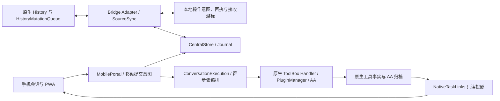

# NativeSync R2.1 架构审查

日期：2026-10-31（America/Adak）。审查基线：`f2a9d1e97b7de945c94f495b7a84a44f40727881`，tree `d35a9917d84e223b50a9be74cd2170f1e0d9427d`。本轮只审查与隔离复现，产品代码改动 0。

## 判断

事实归属和恢复方向基本成立，当前没有推倒重写的依据。但有四项可具体定位的问题：停止受理与排空的生命周期不完整、跨话题积压会重新形成全局阻塞、任务查询两端的容量合同不一致、空闲同步仍重写整个客户端状态。建议先处理这些问题，再继续 PWA 体验扩展。

前两项优先级为 P1：影响维护停启和多话题故障隔离。后两项为 P2：影响长期使用和规模增长。优先级针对本项目持续使用目标，不是新建发布 Gate，也不意味着已经发生生产数据丢失。

## 当前事实与职责

原生 History 负责桌面消息提交，Journal 负责跨端接受顺序，移动执行表负责已接受手机请求的编排，原生 AA 归档负责委托终态。这些对象不是同一种事实。发现的问题主要发生在生命周期、积压和投影边界，并非必须将上述状态合成一个数据库或一个执行内核。

## F1 · P1：beginDrain 中止在途工作，却没有封住新受理入口

位置：`overlays/VCPToolBox/Plugin/NativeSync/mobile/execution.js:65`、`:252`；`mobile/portal.js:105`、`:251`；`compat/host-patches/VCPToolBox-native-execution.patch` 中宿主关闭接线。

`beginDrain()` 设置 draining、停止调度并立即 abort 活动 controller；`accept()` 和手机 messages 路由没有相应的拒绝新受理检查。宿主补丁又在 gracefulShutdown 的起始阶段调用 beginDrain，之后才关闭 HTTP listener 和等待原生请求。

**已复现：** 在真实 MobilePortal、合成 HTTPS 代理语义与 SQLite 下，调用 `portal.beginDrain()` 后，合法 POST messages 仍返回 **202 / queued**，Journal 新增 **1**。没有配置模型 endpoint，新增任务未实际执行。

影响：排空开始后仍能产生新的持久任务和消息，无法把该方法当成已封闭受理入口的维护屏障；同时立即 abort 会让原可正常结束的在途工作进入中断／待核对路径。宿主随后关闭 listener 会缩短窗口，但不能使插件本身的生命周期合同成立。持久 queued 任务仍可恢复，此处没有证明任务丢失。

**修复方向：** 明确区分停止新受理、等待已受理工作、超时后的取消。新提交／邀请以及相关写入口应遵循一致的停机策略；原请求查询和幂等重试需要单独保留语义。利用现有任务状态给出可核对的排空结果，接回现有宿主停机链，无需另建维护平台。

## F2 · P1：一个话题可以耗尽所有话题共享的收件容量

位置：`overlays/VCPChat/modules/services/nativeSync/adapter.js:503`、`:538`、`:592`，尤其 `:602`。

收件队列虽已持久化，仍有全局 1000 条上限。阻塞事件可留在 inbox 中让同一页的其他话题继续，但后续分页必须将整页放入同一个容量池；因此隔离只在积压较小时成立。

**已复现：** A 话题保留一个本地冲突操作，云端连续接受 A 的 1001 次更新，再接受 B 的一条合法消息。以每页 500 条 pull：inbox 达到 **1000**，抛出 **INBOUND_BUFFER_FULL**，cursor 停在 **1007**；B 的事件位于 **1009**，没有物化。原冲突和事件均保留，但 B 也无法继续推进。

影响：一个长期冲突的 Agent／话题会阻塞整个 Source 后续同步，与多 Agent 故障隔离目标不一致。不是把上限从 1000 改大就能消除的问题。

**修复方向：** 将待处理事件的持久积压与内存工作集分开，按话题隔离和公平调度。全局接收游标只能在相应事件已可靠保存后推进；保留原 seq、op、因果关系及重开恢复。可优先复用现有持久分页文件方式，不预设新消息数据库。不能丢弃冲突事件、直接跳游标或用最后写入覆盖来腾空间。

## F3 · P2：服务端无分页返回任务，桌面端在第 10001 条拒绝整份状态

位置：`overlays/VCPToolBox/Plugin/NativeSync/mobile/execution.js:64`；桌面查询接线 `native-sync.js:76` 附近；`overlays/VCPChat/modules/services/nativeSync/executionStatus.js:38`。

服务端 list 查询该话题的全部执行并逐条装配原生任务／工具投影；客户端先拒绝超过 10000 条的响应，再截取最多 128 条作为缓存。两端缺少共同的分页／增量合同。

**已复现：** 在临时执行表内构造共 **10001** 条合法字段的 completed 合成任务，调用真实服务端 list，并交给实际 NativeExecutionStatus.refresh。结果为 **INVALID_EXECUTION_STATUS**，没有旧缓存时返回 0 条任务。此探针验证查询与投影路径，没有真正执行 10001 个任务。

影响：即使所有任务均已完成、同步历史正常，任务状态视图也会在累计数量达到上限后持续刷新失败。有旧缓存时仅保留旧视图；同时，每次轮询在服务端构造完整历史，开销随累计执行数增长。

**修复方向：** 为两端建立一致的有界查询合同，分页或增量取得终态历史，并明确未完成／待核对任务的可见性。客户端上限保护应保留；仅提高阈值或删除旧任务记录都不能替代查询合同。

## F4 · P2：空闲 pull 也克隆并持久重写整份本地账本

位置：`overlays/VCPChat/modules/services/nativeSync/adapter.js:218`、`:601`；`runtime.js:34`、`:120`；实际耐久写实现由宿主 `modules/utils/durableJson.js` 提供。

每次 pull 即使 events 为空、nextSeq 没有变化，仍进入 transaction；transaction structuredClone 整个 state，然后 stringify、写临时文件、fsync、原子替换。acked 随已知消息增加；本地提交意图和回执也共用同一事务队列。默认运行循环间隔为 250ms，实际频率还受网络和工作耗时影响。

**已复现：** 在已同步且无新数据的夹具内连续 synchronize 5 次：状态文件前后 SHA 相同，仍产生 **5 次完整耐久写入**；状态 3815 bytes，本次合计序列化 19075 bytes。这证明空写存在，不是大型历史性能或 SSD 寿命测试。

附带静态观察：SourceSync.report 每个成功循环发送 progress，服务端 observe 执行 UPSERT；执行状态缓存亦会按轮询重新保存。无变化查询、心跳和必须耐久的消息事实没有充分区分提交频率。

影响：空闲 I/O 以及每次状态提交的复制／序列化成本与整个历史规模耦合。源码可确定其线性全量开销；本轮没有测量全量真实历史的卡顿阈值，不将潜在卡顿写成已发生事实。

**修复方向：** 先跳过 events 为空且游标不变的状态提交，对 progress／状态投影按变化或适当心跳保存；游标有推进的空过滤页仍须耐久提交。之后依据实际规模测量决定是否需要增量存储，暂不直接迁入新数据库，也不削弱消息意图／回执的耐久性。

## 保留的设计与未升级为缺陷的事项

- 保留 hash/baseHash、显式删除、原操作幂等和未知执行待核对。没有发现应为“更容易继续”而引入自动 LWW 或重跑未知 AA 的依据。
- 受控同 Source 扩围、事务内固定旧手机权限、两端分别提交并按原 op 恢复，方向合理。本轮没有证据要求改成分布式单事务。
- 宿主三处接线、原生纯规则副本与执行配置快照形成维护耦合；已有来源／SHA 和安装白名单承担匹配工作。需要随实际宿主升级核对，尚不能仅凭存在副本就要求重写执行层或新增兼容审批系统。
- 当前 Bridge 使用宿主行政 Bearer，Source/device/header 是该信任边界内的限域声明，不是面向不可信多租户的独立凭据。个人可信部署下不据此报越权漏洞；若未来要分发给不互信的使用者，需要重新定义凭据作用域。
- 新 Source 搬迁、scope 收窄、JEV/game 云端同等执行仍是明确未支持的边界，不当作本轮新发现的回归。

## 证据与后续顺序

原始探针、TAP 和 RESULT 保存在本地 Git 忽略区 `.local/architecture-review/`。四个独立探针均确认上述现有行为；**探针通过表示问题被复现，不表示产品已修复**。任务查询探针第一次直接加载 overlay，缺少宿主 durableJson，修正为匹配宿主后才验证成功；原夹具失败记录保留，没有计作产品缺陷。

本轮使用 Node 24.22.1、匹配公开宿主夹具、临时 SQLite／AppData、loopback HTTP；没有访问生产、真实模型、真实手机或 Windows。overlays 与 HEAD 逐文件摘要一致。沿用的 119 项和上轮 25 项结果仍按各自范围成立，不能覆盖这四个新增触发条件。

建议实施顺序：**F1 生命周期 → F2 积压隔离 → F3 有界任务查询 → F4 空写与规模测量**。先完成这几项的最小修复和相关反例回归，再推进页面体验；不将本次审查自动扩大为生产安装授权。
