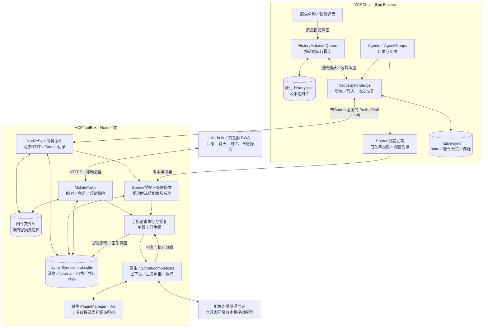

# NativeSync 当前架构与 VCP 集成位置

核对日期：2026-11-01。依据最终交付的实际源码、候选清单和固定开发宿主，未读取聊天正文或凭据。

- NativeSync维护源码：`/home/jenn/.codex/worktrees/nativesync-contract-experiment/NativeSync`。
- 完整运行宿主：`/home/jenn/NativeSync-Dev`，当前使用合成资料和本机模拟模型。
- 应用代码：`ca72335`；交付组装：`b7fbeae`；交付记录：`6f42fcd`。
- 最终候选：`full-source-accepted`，清单SHA256为`ddf0408c85737bdc41e46dafa9bf2654b57e8d3f5d77d0c7568c457ba14b5dfb`。

## 架构图

桌面发送：原生界面通过History队列提交，本地History保存、操作被Bridge捕获，再上传中央账本供手机读取。
手机发送：Portal受理并冻结执行配置，复用ToolBox原生聊天／工具链，结果提交中央Journal；桌面Bridge拉取后经History队列落盘并刷新界面。
历史导入与配置发布分开推进；后台正文缓存最多一个话题，单话题仍按宿主JSON历史读取。

## 谁负责什么

| 对象 | 责任归属 |
| --- | --- |
| 桌面聊天文件与本机写入顺序 | VCPChat HistoryMutationQueue；NativeSync接入其提交和落盘边界 |
| 跨端已接受消息、操作回执、顺序与设备进度 | NativeSync中央消息／Journal及桌面state；不把本地保存误当成远端已接受 |
| 来源与话题范围 | 服务器预先批准的Source绑定和目录归属；手机配对明确授权，旧会话不静默扩权 |
| 续聊配置 | 桌面投影发布，服务器验证版本／摘要／归属；受理后冻结，不随新配置漂移 |
| 手机请求恢复 | NativeSync执行记录、稳定requestId／opId、回复提交意图与已有人工放弃出口 |
| 工具和AA子任务的真实终态 | 原生工具及AgentAssistant；NativeSync保存关联和观察，AA子任务成功不直接证明父请求成功 |
| 图片／文本等文件 | 原生桌面附件与服务器内容寻址文件库；PWA在当前会话内预览／保存 |
| OneRing、RAG、VexusMemo、CDS | 继续保留各自职责；NativeSync没有把这些存储合并成自己的数据权威 |

手机群聊由NativeSync的`mobile/groupTurn.js`持久化和调度群步骤，使用`nativeRules/`中带入的桌面群聊／上下文规则副本，
再调用原生ToolBox执行链；不是远程运行Electron里的整套群聊界面。共享同步契约来自`packages/sync-contracts`，在组装时生成部署文件。

## NativeSync 自身增加／维护的位置

以下路径相对于运行根`/home/jenn/NativeSync-Dev`；对应维护源码在本仓`overlays/`。

| 位置 | 当前用途 | 最终运行文件数 |
| --- | --- | ---: |
| `VCPChat/modules/services/nativeSync/` | Bridge、操作捕获、状态／收件恢复、Source发现／导入、配置发布、附件还原、任务查询 | 22 |
| `VCPChat/modules/nativeSyncSettings/` | 原生Feature设置页，选定／全量模式、预览、配置保存与接入检查 | 6 |
| `VCPToolBox/Plugin/NativeSync/`，不含以下两个子目录 | 服务生命周期、同步／目录、配置授权、手机Portal、执行恢复和附件服务 | 30 |
| `VCPToolBox/Plugin/NativeSync/nativeRules/` | 带入后端使用的原生桌面规则副本，含三种群聊模式及上下文处理 | 16 |
| `VCPToolBox/Plugin/NativeSync/mobile-dist/` | 完整手机PWA构建产物；维护源码在`overlays/VCPToolBox/apps/mobile/` | 8 |
| `VCPToolBox/modules/requestExecutionContext.js` | 请求、取消、审批、工具／AA观察上下文 | 1 |
| `VCPToolBox/Plugin/AgentAssistant/delegationContinuity.js` | 原生委托身份、终态归档和重开查询所需连续性 | 1 |
| 合计 | **84个运行文件，包含新增模块、规则副本和构建产物；不是84个宿主核心修改** | **84** |

核心维护入口：

- [桌面runtime](/home/jenn/.codex/worktrees/nativesync-contract-experiment/NativeSync/overlays/VCPChat/modules/services/nativeSync/runtime.js)、[Source导入](/home/jenn/.codex/worktrees/nativesync-contract-experiment/NativeSync/overlays/VCPChat/modules/services/nativeSync/sourceSync.js)、[配置发布](/home/jenn/.codex/worktrees/nativesync-contract-experiment/NativeSync/overlays/VCPChat/modules/services/nativeSync/sourceExecutionPublication.js)。
- [服务入口](/home/jenn/.codex/worktrees/nativesync-contract-experiment/NativeSync/overlays/VCPToolBox/Plugin/NativeSync/native-sync.js)、[中央存储](/home/jenn/.codex/worktrees/nativesync-contract-experiment/NativeSync/overlays/VCPToolBox/Plugin/NativeSync/sync/centralStore.js)、[Source目录](/home/jenn/.codex/worktrees/nativesync-contract-experiment/NativeSync/overlays/VCPToolBox/Plugin/NativeSync/sync/sourceCatalog.js)。
- [Portal](/home/jenn/.codex/worktrees/nativesync-contract-experiment/NativeSync/overlays/VCPToolBox/Plugin/NativeSync/mobile/portal.js)、[执行](/home/jenn/.codex/worktrees/nativesync-contract-experiment/NativeSync/overlays/VCPToolBox/Plugin/NativeSync/mobile/execution.js)、[群步骤](/home/jenn/.codex/worktrees/nativesync-contract-experiment/NativeSync/overlays/VCPToolBox/Plugin/NativeSync/mobile/groupTurn.js)、[配置授权](/home/jenn/.codex/worktrees/nativesync-contract-experiment/NativeSync/overlays/VCPToolBox/Plugin/NativeSync/mobile/executionConfigs.js)。

## VCPChat 宿主接线位置

这里列当前源码已核对的集成入口，包含以前已经交付的宿主改动和原生共用边界，**不把它们全部算成全量阶段新改**。
完整宿主来自公开Git基础和匹配文件层，不是一个纯净上游提交；本表也不是对任意上游HEAD的完整差异报告。

| 当前宿主位置 | 与NativeSync有关的接入内容 |
| --- | --- |
| [main.js:1279](/home/jenn/NativeSync-Dev/VCPChat/main.js:1279) | 建立共享History队列，注册native-history IPC，启动Bridge，注入配置／附件能力与通知；退出时关闭Bridge。Feature注册也由宿主提供能力 |
| [renderer.js:1226](/home/jenn/NativeSync-Dev/VCPChat/renderer.js:1226) | 远端History刷新与任务状态面板，避免覆盖正在流式生成、编辑或尚未保存的本地工作 |
| [preloads/api/chat.js:27](/home/jenn/NativeSync-Dev/VCPChat/preloads/api/chat.js:27) | 暴露History快照、消息／终态提交、本地提交重试、同步状态及执行／AA结果查询IPC |
| [historyMutationQueue.js:44](/home/jenn/NativeSync-Dev/VCPChat/modules/services/historyMutationQueue.js:44) | 原生按话题串行写入，写前准备消息意图，耐久保存后通知Bridge；远端落盘和本地新操作有区分 |
| [nativeHistoryHandlers.js](/home/jenn/NativeSync-Dev/VCPChat/modules/ipc/nativeHistoryHandlers.js) | 快照、消息操作、流式终态和本地提交恢复的IPC处理 |
| [syncWriterBoundary.js](/home/jenn/NativeSync-Dev/VCPChat/modules/services/syncWriterBoundary.js) | 防止旧MobileSync同时写同一History；原生显式删除通过Source提交路径确认 |
| [chatHandlers.js:642](/home/jenn/NativeSync-Dev/VCPChat/modules/ipc/chatHandlers.js:642)、[groupChatHandlers.js:167](/home/jenn/NativeSync-Dev/VCPChat/modules/ipc/groupChatHandlers.js:167) | 单聊／群聊历史读写走共享队列；同步话题的整段替换需核对版本 |
| [agentHandlers.js:600](/home/jenn/NativeSync-Dev/VCPChat/modules/ipc/agentHandlers.js:600)、[chatHandlers.js:735](/home/jenn/NativeSync-Dev/VCPChat/modules/ipc/chatHandlers.js:735)、[sideChatHandlers.js:102](/home/jenn/NativeSync-Dev/VCPChat/modules/ipc/sideChatHandlers.js:102) | Agent、话题、辅助对话的明确删除，以及辅助对话目录变化通知；文件读失败不当成删除 |
| [chatRepository.js](/home/jenn/NativeSync-Dev/VCPChat/modules/chat/chatRepository.js)、[chatHistoryMutationAuthority.js](/home/jenn/NativeSync-Dev/VCPChat/modules/chat/chatHistoryMutationAuthority.js)、[historyMessageIntent.mjs](/home/jenn/NativeSync-Dev/VCPChat/modules/chat/historyMessageIntent.mjs) | 渲染器消息操作、期望版本和因果身份传递，接到主进程History权威 |
| [singleChatRequestOrchestrator.js](/home/jenn/NativeSync-Dev/VCPChat/modules/chat/singleChatRequestOrchestrator.js)、[event-listeners.js:263](/home/jenn/NativeSync-Dev/VCPChat/modules/event-listeners.js:263)、[messageContextMenu.js:1271](/home/jenn/NativeSync-Dev/VCPChat/modules/renderer/messageContextMenu.js:1271) | 正常发送、相关非流式收尾与重新生成时保留请求和因果上下文 |
| [Groupmodules/groupchat.js:262](/home/jenn/NativeSync-Dev/VCPChat/Groupmodules/groupchat.js:262) | 桌面群聊消息经原生队列提交，保留消息和上下文身份；max_tokens补丁另见下表 |
| [nativeHistoryRefresh.js](/home/jenn/NativeSync-Dev/VCPChat/modules/chat/nativeHistoryRefresh.js)、[nativeExecutionStatus.js](/home/jenn/NativeSync-Dev/VCPChat/modules/renderer/nativeExecutionStatus.js) | History刷新协调、提交／任务状态和启动失败原因显示 |
| [pluginAgentOperationService.js:691](/home/jenn/NativeSync-Dev/VCPChat/modules/services/pluginAgentOperationService.js:691) | 已有插件建话题／写消息使用同一History队列；这是共用原生能力，不是独立NativeSync业务层 |
| [VCPMobileSync/index.js:150](/home/jenn/NativeSync-Dev/VCPChat/VCPDistributedServer/Plugin/VCPMobileSync/index.js:150)、[transport/routes.js:357](/home/jenn/NativeSync-Dev/VCPChat/VCPDistributedServer/Plugin/VCPMobileSync/transport/routes.js:357)、[error-contract.js:100](/home/jenn/NativeSync-Dev/VCPChat/VCPDistributedServer/Plugin/VCPMobileSync/error-contract.js:100) | 旧同步入口共存时核对写入边界并返回SYNC_WRITER_EXCLUDED，避免双写；本开发配置没有启用CDS镜像 |

`modules/appFeatures.js`、设置扩展、renderer Feature宿主、preload registry和`quitAdmission.cjs`属于匹配宿主能力要求；
NativeSync设置Feature复用它们，不应仅因出现在宿主摘要清单就全算作NativeSync新改。
`modules/utils/durableJson.js`和旧canonical/hash同样属于明确的共用依赖。

## VCPToolBox 宿主接线位置

| 当前宿主位置 | 接入内容 |
| --- | --- |
| [server.js:558](/home/jenn/NativeSync-Dev/VCPToolBox/server.js:558)、[server.js:567](/home/jenn/NativeSync-Dev/VCPToolBox/server.js:567) | 手机路由先由Portal处理会话，再保留现有Bearer路径；安装请求执行上下文中间件 |
| [server.js:1580](/home/jenn/NativeSync-Dev/VCPToolBox/server.js:1580)、[server.js:1643](/home/jenn/NativeSync-Dev/VCPToolBox/server.js:1643) | 可信原生执行端点从宿主监听入口注入；正常退出时停止受理并排空 |
| [Plugin.js:1308](/home/jenn/NativeSync-Dev/VCPToolBox/Plugin.js:1308)、[Plugin.js:1472](/home/jenn/NativeSync-Dev/VCPToolBox/Plugin.js:1472) | 取消、等待审批、工具派发及结算观察；保持调用身份与未知副作用边界 |
| [AgentAssistant.js:79](/home/jenn/NativeSync-Dev/VCPToolBox/Plugin/AgentAssistant/AgentAssistant.js:79)、[AgentAssistant.js:820](/home/jenn/NativeSync-Dev/VCPToolBox/Plugin/AgentAssistant/AgentAssistant.js:820) | 注册原生任务查询提供者，记录接受身份、终态和报告；重开核对原委托，不重派 |
| [requestExecutionContext.js](/home/jenn/NativeSync-Dev/VCPToolBox/modules/requestExecutionContext.js)、[delegationContinuity.js](/home/jenn/NativeSync-Dev/VCPToolBox/Plugin/AgentAssistant/delegationContinuity.js) | 上述接线调用的两个维护模块，计入84项载荷 |

这三处既有核心文件的NativeSync基线补丁在`compat/host-patches/VCPToolBox-native-execution.patch`。
开发宿主已含这些接线及其他stdio增量，不能把历史before/after当作当前整个server.js／Plugin.js摘要，也不能盲目重复应用。
NativeSync没有给AgentManager打全局映射补丁，仍复用其原生解析。

启动环境曾补齐`modules/nativeConversationTransport.js`和`modules/pluginRuntimeEnvSandbox.js`两个公开宿主缺失模块。
它们是原生会话stdio传输与外部插件环境隔离的宿主依赖恢复，不是本轮全量同步发明的新模块，也不在本候选84项载荷中。

## 最终包额外携带的三个兼容补丁

| 文件 | 实际修正 | 补丁来源 |
| --- | --- | --- |
| `VCPChat/modules/renderer/nativeExecutionStatus.js` | Bridge未接入时显示具体错误，避免面板隐藏后误以为同步正常 | `VCPChat-startup-diagnostics.patch` |
| `VCPChat/modules/services/pdfAttachmentService.js` | Linux使用Poppler CLI渲染PDF；PDF文本读取适配Uint8Array | `VCPChat-linux-pdf.patch` |
| `VCPChat/Groupmodules/groupchat.js` | 群聊请求透传成员模型的max_tokens | `VCPChat-group-parameters.patch` |

三项均有独立before/after和补丁摘要，安装器只在匹配目标应用；它们不是三个“包含全部宿主接线”的总补丁。

## 配置、数据与开发工具

桌面独立连接配置位于`data/chat/.native-sync/connection.json`，进度在同目录state／收件文件；
原生资料仍位于`data/chat/Agents`、`AgentGroups`、`UserData`。
服务器批准的Source配置由`NativeSyncFullSources`提供；中央SQLite和附件在`data/native-sync/`。
手机只获得配对后的移动会话权限，服务器凭据不随执行配置下发。

`tools/dev-environment/`及固定环境`bin/`负责启停、模拟模型、独立验证、临时手机网关；
故障预加载、代理和合成效果插件只属于验证实例，没有成为产品故障API。
固定开发环境和测试副本的配置不属于生产部署；本次整理没有修改任何运行代码、配置或数据。

逐文件清单见配套`NativeSync_VCP_Change_Inventory_20261101.json`：84项载荷、三个补丁及当前宿主集成位置均带摘要。
宿主完整指纹以候选`compat/dev-hosts/linux-full.json`为准，历史Windows清单不能替代本机组合。
